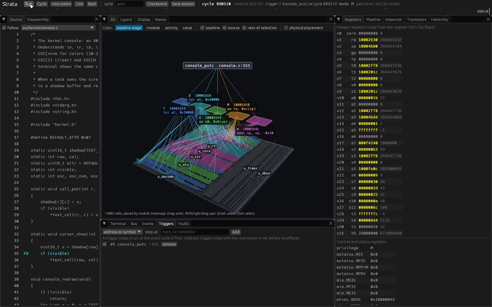
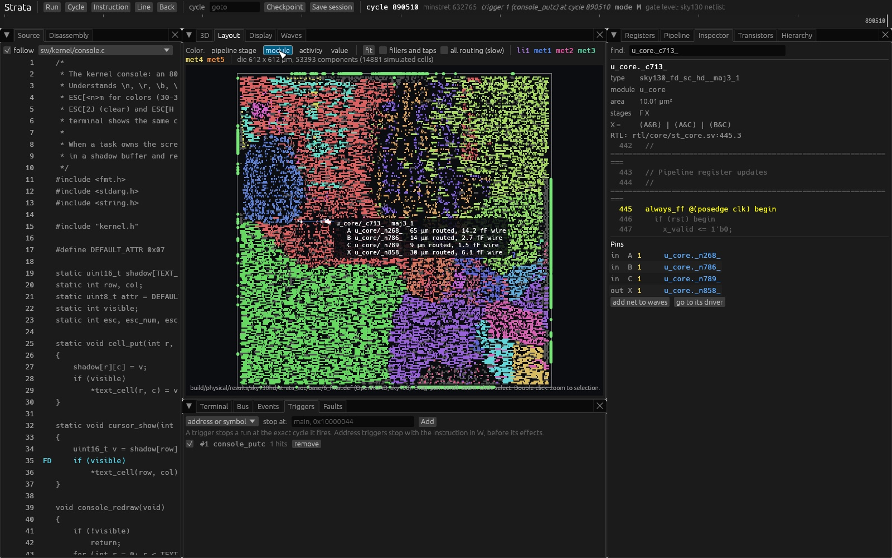
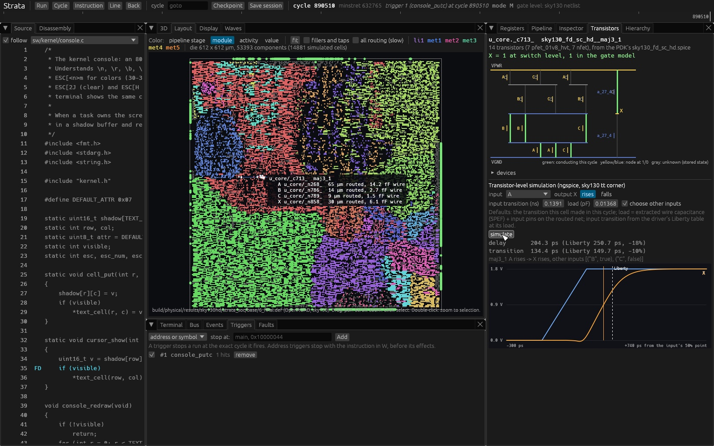

# Debugger

`strata-dbg` is a native desktop application for watching software run on
the Strata hardware. It runs the machine on the gate-level model (the sky130
netlist, see [abstractions.md](abstractions.md)) and relates every level of
the system to every other: C and assembly source, instructions, the pipeline,
bus transactions, RTL modules, netlist cells and nets, the placed and routed
layout, and the transistors inside a cell.

```
tools/target/release/strata-dbg                 # boots the OS from the flash image
tools/target/release/strata-dbg --ram test.hex  # runs a program preloaded into RAM
```

It is built from two crates:

* `strata-debug`: the debug session and the inspection model, with no user
  interface. It is tested on its own (`cargo test -p strata-debug`).
* `strata-dbg`: the interface (eframe, egui_dock, wgpu).

## The session

A session is the gate-level machine plus everything needed to move through
its execution:

* **Deterministic replay.** The machine's only inputs are the boot files and
  a timeline of host events (terminal input, button changes, resets) and
  fault injections, each stamped with the cycle at which it takes effect.
  Running from cycle 0 with the same timeline reproduces every net value in
  every cycle.
* **Checkpoints.** Every 100,000 cycles, and on request, the session stores
  a complete snapshot: every flip-flop and net of the netlist, the memory
  macros, and the board devices (UART, flash, display, buttons). Moving to
  any cycle restores the nearest earlier checkpoint and replays forward, so
  going backwards costs at most one checkpoint interval of simulation.
* **Settled state.** Between steps the machine rests at a cycle with all
  nets holding that cycle's values, before its clock edge. What the
  interface shows is exactly what the netlist holds at that point.
* **Saving.** A session (configuration, timeline, triggers) is saved as JSON
  and reopened with `--session`, which replays it.

### Triggers

Triggers are evaluated in every cycle and stop the machine at exactly the
cycle on which they fire:

| Trigger | Fires when |
|---------|-----------|
| commit | the instruction at an address is in W and completes this cycle; the state shown is before its effects (a breakpoint) |
| source line | an instruction of a C or assembly line is about to complete |
| access | a data-bus access overlaps an address range (read, write or both) |
| signal compare | a netlist signal compared with a value (`=`, `!=`, `<`, `>=`) |
| signal change | a netlist signal changes |
| trap | a trap is taken (optionally a given cause, interrupt or exception) |
| cycle | the machine reaches a cycle |
| terminal | the terminal output ends with some text |
| halt | the machine halts |

Stepping by instruction runs until the next commit, and reverse stepping
returns to the cycle of the previous commit by checkpoint and replay.

### Fault injection

Faults are events on the timeline, so they replay like inputs:

* stuck-at: force a net to 0 or 1 from a cycle on (and release it later);
* upset: invert the stored bit of a flip-flop at a cycle;
* memory bit flip: invert one bit of a word in ROM, RAM, VRAM or font RAM.

The gate-level model makes these physical: a stuck-at net affects every cell
it drives, whatever the RTL intended.

## The inspection model

The inspection model relates the objects of the system for any cycle:

| Object | Where it comes from |
|--------|---------------------|
| source lines, functions, symbols | debug information written by `strata-as` for each image (`.sdb`): address to source line, symbols, sections |
| instructions and pipeline | the PC and instruction registers of each stage, read from netlist flip-flops; disassembly of the words |
| registers and CSRs | the register file and CSR flip-flops in the netlist |
| retired instructions | the core's trace port (`trace_*`, part of the netlist) |
| bus transactions | the core's instruction and data bus ports, observed at the netlist boundary |
| modules | the RTL hierarchy kept through synthesis: every cell belongs to one module instance |
| cells and nets | the netlist; functions from the Liberty library; RTL source line of each cell from synthesis |
| pipeline stage of a cell | the fan-in cone of each stage's pipeline registers |
| activity | toggle counts of every net, live or over a replayed window |
| layout | placement and routing from OpenROAD (DEF, SPEF), matched to cells by name |
| transistors | the PDK's transistor netlist of the cell type, simulated with ngspice |

Nothing in the views is drawn from the RTL or from a model of the
instruction set: register values are flip-flop contents, the pipeline is
flip-flop contents, and the instruction text is the disassembly of words
held in the machine.

## Views

| Tab | Shows |
|-----|-------|
| Source | the C or assembly source of the code in flight, with the pipeline stage of each instruction; click a line for a breakpoint |
| Disassembly | memory around the PC, with symbols |
| Registers | x0 to x31 (changes highlighted), privilege mode, CSRs, all read from the netlist |
| Pipeline | each stage's PC and instruction (from its pipeline register when the stage holds the word), hazard and flush signals, completed instructions |
| Terminal | the UART as a terminal, and the board's buttons and LEDs |
| Display | the frame captured from the video pins |
| Bus | data and instruction bus transactions with responses |
| Events, Triggers, Faults | the event log, the trigger list, fault injection and the input timeline |
| Waves | waveforms of any signals over a window, rebuilt by replay; VCD export |
| Hierarchy | the module tree with cell counts and area |
| Inspector | a cell: type, module, RTL source line, Liberty functions, pin values and nets |
| 3D | the inspection scene (below) |
| Layout | the placed and routed layout (below) |
| Transistors | the selected cell at transistor level (below) |

Selection is shared: a cell picked in the 3D view, the layout or the
hierarchy is the cell in the inspector and the transistor view.

### 3D



The 3D view is built from the inspection model. Every object in it is an
entity of the model, and selecting it selects that entity:

* **Cells.** Every netlist cell is a box on the floor. Its height and color
  show activity, pipeline stage, module or logic value. The cells whose
  output changed in the current cycle are raised.
* **Placement.** Either a treemap of the RTL module hierarchy, or the
  physical placement from the layout. In the physical placement, the cells
  the layout flow added (clock tree, repair buffers, tie cells, antenna
  diodes) are shown in gray. They are not part of the simulated netlist,
  and fillers and well taps are omitted.
* **Modules.** Each RTL instance is an outlined region.
* **Pipeline.** Five plates (F, D, X, M, W) above the cells, each labeled
  with the instruction in that stage and tied by lines to the region of the
  netlist that implements the stage and to that stage's cells that switched
  in this cycle.
* **Source.** The source line of the newest instruction in flight hovers
  above the pipeline, tied to each stage that holds an instruction.
* **Nets.** For the selected cell: in the treemap, arcs to the drivers of its
  inputs and the readers of its outputs; in the physical placement, the
  routed wires and vias of its nets from the layout, at the height of their
  metal layer (li1 to met5).

Activity coloring uses the toggle counts of the last cycles, or of a window
of cycles measured by replay ("measure"), which gives a stable activity map
of, for example, the game's main loop.

### Layout



The layout tab draws the placed and routed design from above, from the
OpenROAD output (`build/physical`, see [physical.md](physical.md)):
every cell at its placed location with the same coloring as the 3D view,
the cells the flow added in gray, the I/O pins, and the routed wires and vias
of the selected cell's nets with their layer colors and widths. The label of
the selected cell gives each net's routed length and extracted wire
capacitance. Clicking a cell selects it everywhere.

### Transistors



The transistor tab shows the selected cell's transistor netlist from the PDK.
Each stage is drawn as its pull-up network (pfet) above the output node and
its pull-down network (nfet) below it.

* **Switch-level state.** The cell's input values in the current cycle
  determine which transistors conduct (drawn green) and the value of each
  internal node. The view checks that the output this gives equals the
  gate-level model's output. Nodes that hold state (inside flip-flops) show
  as unknown.
* **Transistor-level simulation.** "simulate" runs ngspice on the cell for
  the transition it made in the current cycle. The other inputs keep their
  values from that cycle, or the simulator picks a sensitizing condition. The
  load is the extracted capacitance of the routed output net (SPEF) plus the
  input capacitance of the pins on it. The input transition comes from the
  Liberty table of the driving cell at its load. The view plots the input
  and output voltages and gives the delay and output transition next to the
  values the Liberty tables predict for the same conditions.

## Fidelity

* The machine is the gate-level model: cycle-based and zero-delay. The
  debugger shows logic values per cycle, not timing within a cycle. Timing
  within a cycle is covered by static timing analysis (FPGA and layout
  flows) and, for single cells, by the transistor view.
* Layout geometry is exactly what OpenROAD wrote. The routed net of a cell
  pin ends where the flow inserted a buffer; the rest of the logical net is
  on the buffer's other side.
* Transistor-level results are for the typical corner, with the PDK's
  schematic cell netlists (no layout parasitics inside the cell) and a
  lumped load; see [physical.md](physical.md#transistor-level-analysis).

## Headless use

`--tour <dir>` performs the steps of [guide.md](guide.md#4-use-the-debugger)
through the interface itself (typing a breakpoint, Run, finding a cell,
opening the layout and transistor views, simulating) and saves a screenshot
of each step; the pictures in the guide are made this way.

The debugger also renders single views offscreen:

```
strata-dbg --screenshot out.png [--size 1600x1000] [--goto <cycle>] [--break <symbol>]
           [--select <cell>] [--type <text>] [--color stage|module|activity|value]
           [--physical] [--tab layout|transistors] [--simulate]
```
