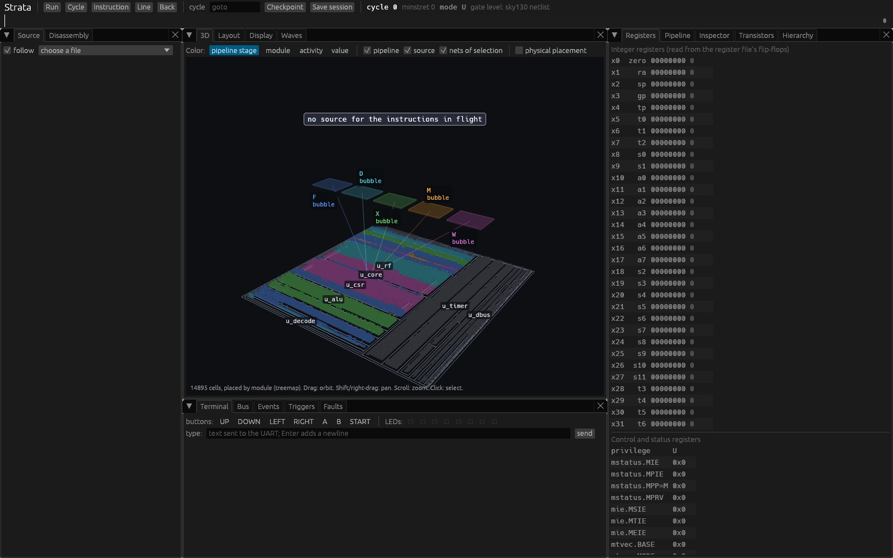
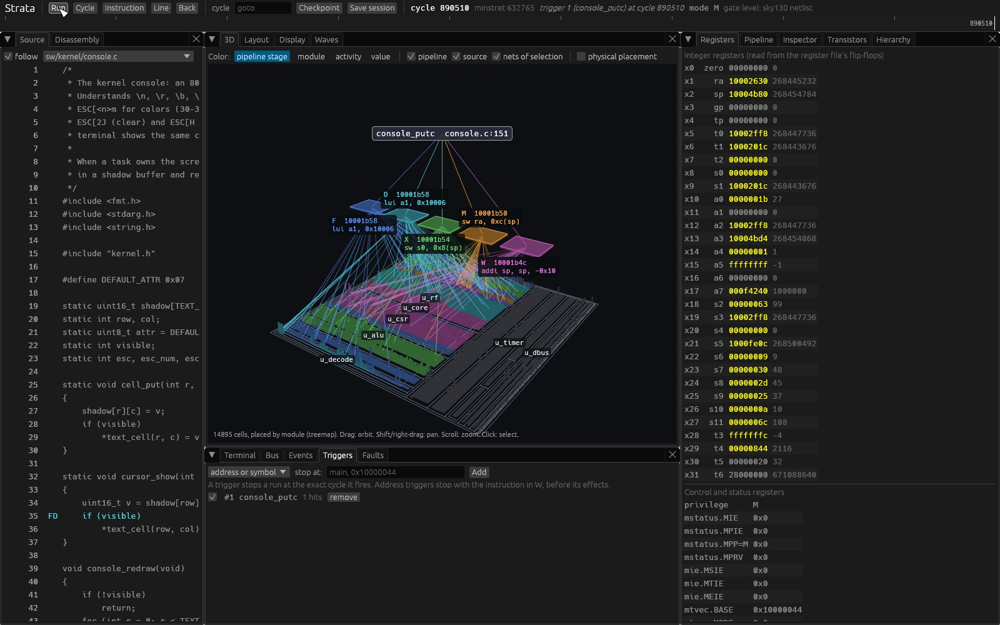
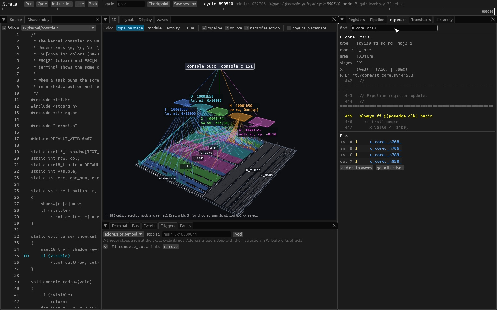
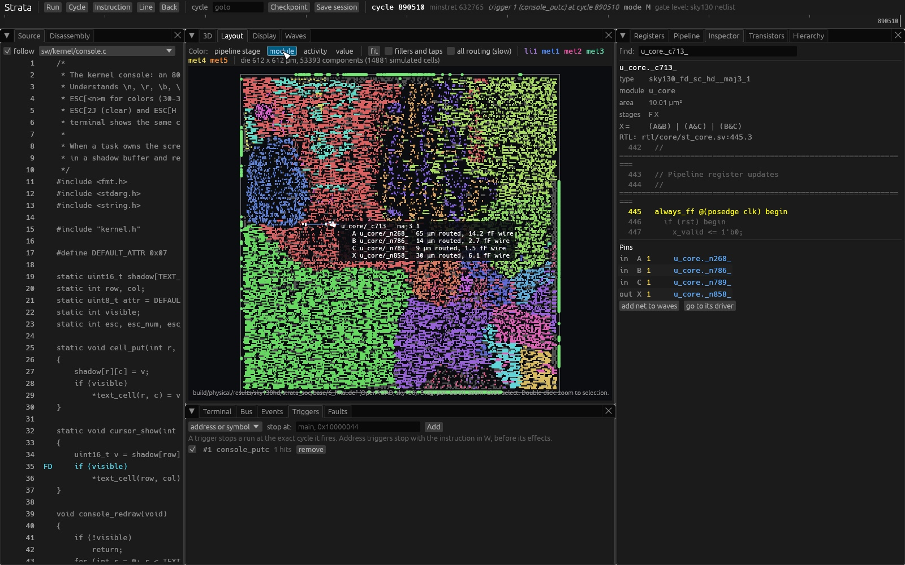
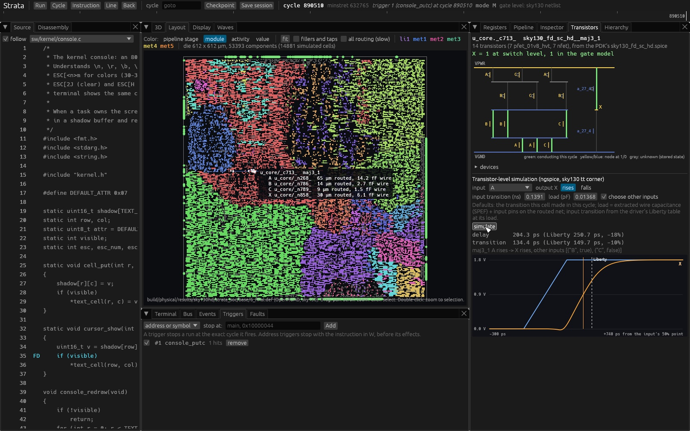
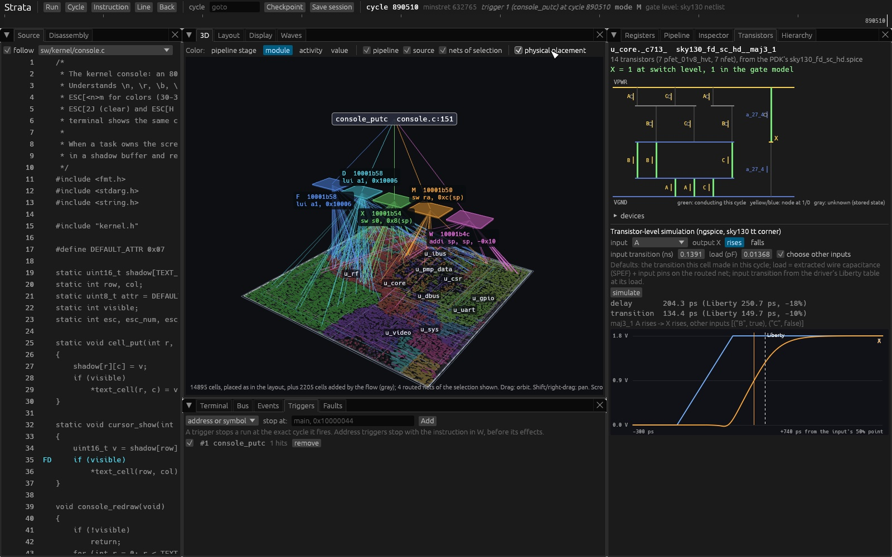

# Using Strata

This guide shows how to use the computer from a terminal, how to play its
game, and how to use the debugger to see what the hardware is doing, step by
step. Commands are run from the top of the repository.

## 1. Build everything once

Install the tools listed in [setup.md](setup.md), then:

    scripts/fetch_third_party.sh
    cargo build --release --manifest-path tools/Cargo.toml
    make -C sw
    python3 scripts/synth_gate.py

The second line builds the programs in `tools/target/release/` (strata-run,
strata-dbg and the others), the third builds the boot ROM, the operating
system and the programs into `build/sw/`, and the last synthesizes the
hardware into the gate-level netlist in `build/gate/`.

## 2. Use the computer from a terminal

    tools/target/release/strata-run --engine rtl --interactive

Your terminal is now the computer's serial console. The boot messages
appear, then the shell prompt:

    Strata boot ROM 1.0
    boot: loading from flash
    boot: starting at 0x10000000
    Strata kernel 1.0: 64 KiB RAM, 25 MHz, flash id ef4018
    program store: 5 programs
    Type 'help' for commands.
    strata>

The bottom line of the terminal is a status line: the eight LEDs of the
board, the clock cycle the machine has reached, and how fast the simulation
runs.

Keys:

| Key | Does |
|-----|------|
| letters, Enter | type a command |
| Backspace, Ctrl-U | delete a character, delete the line |
| Up arrow | recall the previous command |
| Ctrl-C | stop the program running in the foreground; at the prompt, discard the line |
| Ctrl-T | switch between the serial console and the video screen |
| Ctrl-] | quit strata-run |

Things to try at the prompt:

| Type | What happens |
|------|--------------|
| `help` | lists the commands |
| `ls` | lists the programs stored in the flash |
| `hello` | a program says hello and how long the machine has been running |
| `info` | clock, memory, uptime, cycles, instructions, cycles per instruction |
| `counter &` | a program counts on the LEDs in the background: watch the status line. `ps` lists it with its pid; `kill` and that pid stops it |
| `counter` | the same in the foreground; it never ends, so press Ctrl-C |
| `crash 3` | a program writes outside its memory; the kernel stops it and the shell carries on (`crash 1` to `crash 6` are six different faults) |
| `blocks` | the game; see section 3 |
| `sleep 1000` | waits one second of the machine's time |
| `halt 0` | stops the machine; strata-run exits |

`--engine rtl` runs the RTL simulation, about 4 million cycles per second, so
the machine runs about 6 times slower than real hardware at 25 MHz. Without
it, strata-run uses the gate-level model, where every one of the 14,895
logic cells is evaluated each cycle. It behaves identically but runs about
30,000 cycles per second, so the boot takes about a minute:

    tools/target/release/strata-run --interactive

## 3. Play the game

The game draws on the computer's video output, not on the serial console.
Ctrl-T shows the video output in the terminal (an 80 by 30 text screen, so
the terminal must be at least 80 columns wide and 31 lines tall). To start
on the screen directly:

    tools/target/release/strata-run --engine rtl --screen

Type `blocks` and press Enter. Controls:

| Key | Does |
|-----|------|
| Left, Right arrows | move the piece |
| Up arrow or x | rotate |
| z | rotate the other way |
| Down arrow | fall faster |
| Space | drop |
| p | pause |
| q or Ctrl-C | quit the game |

The game counts time in video frames. The RTL model shows about 10 frames
per second instead of 60, so the game runs at about a sixth of its real
speed. `blocks demo` lets the computer play (any key stops it). Ctrl-T
returns to the serial console.

## 4. Use the debugger

    tools/target/release/strata-dbg

A window opens with the machine stopped at cycle 0. The debugger always runs
the gate-level model, because every view in it is read from the netlist.

The window has a toolbar and a timeline at the top, and four groups of tabs:

* toolbar: **Run** (and Pause), **Cycle** (one clock cycle), **Instruction**
  (to the next completed instruction), **Line** (to the next source line),
  **Back** (to the previous instruction), a **cycle** box (type a cycle
  number and press Enter to go there, forward or backward), **Checkpoint**,
  **Save session**;
* timeline: click anywhere to go to that cycle;
* left: **Source**, **Disassembly**;
* middle: **3D**, **Layout**, **Display**, **Waves**;
* right: **Registers**, **Pipeline**, **Inspector**, **Transistors**,
  **Hierarchy**;
* bottom: **Terminal**, **Bus**, **Events**, **Triggers**, **Faults**.

Click a tab's title to show it. The steps below produce the pictures shown
with them.

### 4.1 Stop inside the operating system

1. Click the **Triggers** tab at the bottom.
2. In the **stop at:** box type `console_putc` (the kernel function that
   writes a character to the console) and click **Add**.
3. Click **Run**.

About 30 seconds later the machine stops at cycle 890,510, when the first
instruction of `console_putc` is about to complete:

* **Source** (left) shows the C file of the kernel, `console.c`; the letters
  in the margin are the pipeline stages (F, D, X, M, W) holding instructions
  of the lines next to them.
* **3D** (middle) shows every cell of the netlist as a box, grouped by
  hardware module (`u_core` is the processor, `u_alu` its arithmetic unit,
  `u_video` the display controller and so on), colored by pipeline stage.
  Above them float the five pipeline stages, each labeled with the
  instruction it holds, tied with lines to the cells that switched in this
  cycle; above those, the source line being executed. Drag to turn the view,
  right-drag or Shift-drag to move it, scroll to zoom, click a box to select
  that cell, double-click to zoom in on it.
* **Registers** (right) shows the processor's registers, read from the
  flip-flops of the register file.

Now try the toolbar: **Instruction** a few times, then **Back**, and watch
the pipeline and the source line move.

### 4.2 Select a cell

Click a box in the 3D view, or click the **Inspector** tab, type
`u_core._c713_` in the **find:** box and press Enter. That cell is a
`maj3_1` gate of the processor's adder (its carry chain):

The inspector shows the cell's type, module, its logic function from the
cell library, the line of Verilog it came from, and the value on each pin in
this cycle. Click a net name to follow it, or **go to its driver** to jump to
the cell that drives it.

### 4.3 See the cell in the physical layout

Click the **Layout** tab (middle), then **module** in its Color row:

This is the chip layout produced by OpenROAD in the SkyWater 130 nm process:
every cell at the position where it is placed on the 612 by 612 µm die,
colored by module. The selected cell is white, with the real metal wires of
its connections drawn in the colors of their metal layers, and a label with
each wire's routed length and capacitance. Scroll to zoom, drag to move,
double-click to zoom to the selected cell.

The layout is built by `python3 scripts/physical.py` (it needs Docker and
takes about 15 minutes). Until it has been run, the tab says so.

### 4.4 See the transistors inside the cell

Click the **Transistors** tab (right), then **simulate**:

The drawing shows the cell's 14 transistors as the PDK defines them. Green
transistors conduct with the input values of this cycle, and the node colors
show 1 (yellow) and 0 (blue). **simulate** runs ngspice, a circuit simulator,
on the cell with the load of its real wires from the layout, and plots the
input and output voltages. The numbers compare the measured delay with the
value the cell library predicts.

### 4.5 See the physical placement in 3D

Click the **3D** tab and tick **physical placement**:

The cells now sit where they are on the chip, and the selected cell's wires
are drawn at the height of their metal layer.

### 4.6 More

* **Terminal** (bottom): type into the machine's shell (for example `help`
  then Enter). The board buttons (UP, DOWN, LEFT, RIGHT, A, B, START) stay
  pressed when clicked until clicked again; the LEDs are shown next to them.
  Press **Run** first so the machine is running.
* **Display** (middle): the video output. On the gate-level model a frame
  takes about 14 seconds, so the game is very slow here; use strata-run
  (section 3) to play it.
* **Waves** (middle): type a signal name such as `u_core.w_pc`, click
  **add**, then **capture** to see its waveform over the last cycles.
* **Faults** (bottom): with a cell selected, **Stuck at 0** or **Stuck at 1**
  forces its output wire (**Release** frees it) and **Upset selected
  flip-flop** inverts the bit a flip-flop holds; **memory bit flip** takes an
  address and a bit number, such as `0x10000100 3`. Then press **Run** and
  watch what the machine does. Faults are part of the timeline, so going back
  and running again repeats them exactly.
* **Bus**, **Events**, **Pipeline**, **Hierarchy**: memory transactions,
  traps and interrupts, completed instructions, and the module tree.

The steps of 4.1 to 4.5 can be replayed automatically, which also recreates
these pictures:

    tools/target/release/strata-dbg --tour build/tour

## 5. Look at the pictures and documents

The pictures in `docs/images` are ordinary image files. On macOS:

    open docs/images/guide-2-breakpoint.jpg

The documents in `docs` are Markdown. In VS Code, open one and press
Cmd-Shift-V (Ctrl-Shift-V on Linux) to see it with its pictures; on GitHub
they are shown formatted.

## 6. Tests and the implementation flows

| Command | What it does | Time |
|---------|--------------|------|
| `python3 scripts/machine_tests.py --quick` | complete sessions (boot, shell, faults, game, Ctrl-C) compared with recorded results | 30 seconds |
| `python3 scripts/machine_tests.py` | the same on the gate-level model | about 15 minutes |
| `python3 scripts/isa_tests.py --engine lockstep` | RISC-V instruction tests, RTL and gate-level compared every cycle | 20 seconds |
| `python3 scripts/equiv.py` | proves each netlist module equivalent to its Verilog | 5 minutes |
| `python3 scripts/formal.py` | formal checks of every instruction | 5 minutes |
| `python3 scripts/four_state.py` | tests in a simulator that tracks unknown values | 5 minutes |
| `python3 scripts/fpga.py --device 85k` | FPGA bitstream for the ULX3S board | 1 minute |
| `python3 scripts/fpga_sim.py` | simulates the whole FPGA design, including the HDMI signal | 1 minute |
| `python3 scripts/physical.py` | chip layout with OpenROAD (Docker) | 15 minutes |
| `tools/target/release/strata-spice verify` | checks every cell type at transistor level | 20 seconds |

Results are written to `results/`; [results.md](results.md) explains them.
To put Strata on a ULX3S board, follow [fpga.md](fpga.md#bring-up).

## 7. If something does not work

| Problem | Fix |
|---------|-----|
| strata-run or strata-dbg cannot find `build/sw/...` | run `make -C sw` |
| strata-dbg cannot find `build/gate/strata_soc.json` | run `python3 scripts/synth_gate.py` |
| nothing appears after `blocks` in the terminal | press Ctrl-T to see the video screen |
| a program in the terminal does not finish | press Ctrl-C |
| the Layout tab has no layout | run `python3 scripts/physical.py` |
| the Transistors tab says analysis is unavailable | install ngspice and the sky130 PDK ([setup.md](setup.md)) |
