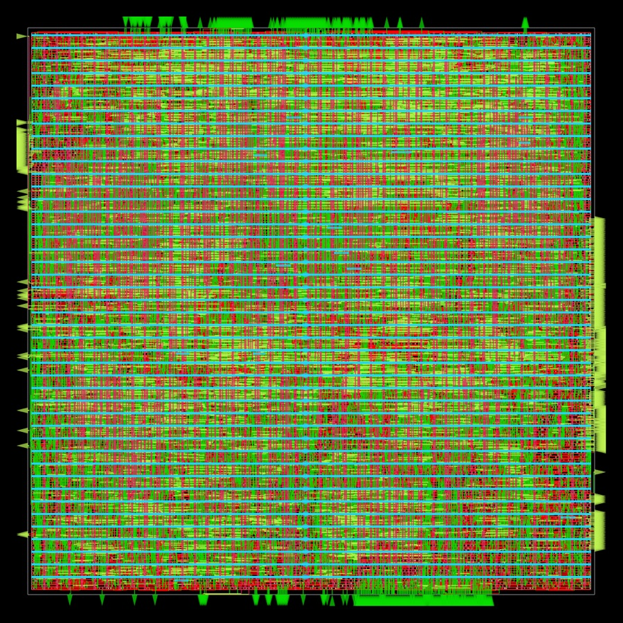

# Physical design and transistor-level analysis

This document covers the two levels below the gate-level netlist: the
physical layout of the netlist in the SkyWater sky130 process, and the
behavior of the standard cells at transistor level. Both are made from real
tool output (OpenROAD, ngspice with the foundry models) and both are
connected to the debugger ([debugger.md](debugger.md)).

## Layout

### Scope

The layout is the `strata_soc` block: the same gate-level netlist that the
simulator runs (`build/gate/strata_soc.v`, 14,895 cells), placed and routed as
a block with its ports as pins. The memory macros (ROM, RAM, VRAM, font RAM)
are outside the block, as they are outside the gate-level model
([abstractions.md](abstractions.md)); a chip would place SRAM macros next to
it. There is no pad ring. This is a demonstration that the netlist can be
implemented in the process, not a tape-out.

### Flow

`scripts/physical.py` runs [OpenROAD-flow-scripts](https://github.com/The-OpenROAD-Project/OpenROAD-flow-scripts)
from the `openroad/orfs` Docker image with `physical/config.mk`:

* platform `sky130hd` (sky130_fd_sc_hd cells, typical corner);
* synthesis skipped (`SYNTH_NETLIST_FILES`): the input is the simulated
  netlist;
* 45% core utilization, square core;
* one 25 MHz clock (`physical/strata_soc.sdc`), with 20% of the period
  budgeted outside the block for inputs and outputs;
* design-rule repair with 20% slew and capacitance margin.

The stages are floorplan and power grid, global placement, resizing and
buffering, detailed placement, clock tree synthesis, global and detailed
routing, antenna repair, filler insertion, parasitic extraction, final
reports and GDS output (KLayout). The flow takes about 14 minutes under
emulation on an Apple M-series machine.

### Correspondence with the simulated netlist

The flow changes the netlist in ways that do not change its function: it
builds a clock tree, inserts buffers on long or heavily loaded nets, resizes
cells, gives each constant input its own tie cell, and adds antenna diodes,
well taps and fillers. Two checks establish that the layout still implements
the simulated netlist:

1. **Read correctly.** `scripts/netlist_compare.py` compares the netlist
   OpenROAD read (`1_synth_lec.v`) with the simulator's netlist: same
   instances, same cell types, and every input pin driven by the same output
   pin. The only difference is 4 cells that drive nothing (they exist to keep
   4 control signals observable in the simulator: `w_busy`, `m_go`,
   `x_hazard`, `x_go`), which the flow removes as dead logic.
2. **Implemented correctly.** kepler-formal (the equivalence checker shipped
   with OpenROAD-flow-scripts) proves the final routed netlist
   (`6_final_lec.v`) combinationally equivalent to the netlist that was read,
   with flip-flops matched by name.

Every simulated cell keeps its name in the layout (`u_core/_c1878_` is cell
`u_core._c1878_` of the gate-level model), which is how the debugger places
cells at their layout positions and finds their routed nets and extracted
capacitance. 14,881 of the 14,895 simulated cells are in the layout; the
other 14 are the 4 observation-only cells above and the 10 shared tie cells,
which the flow replaces with one tie cell per constant input.

### Results

From `results/physical/summary.json` (OpenROAD-flow-scripts, `openroad/orfs` image of 2026-09-28):

| Measure | Value |
|---------|-------|
| Die | 0.374 mm² (about 612 by 612 µm) |
| Standard-cell area | 195,446 µm², 53.9% of the core |
| Instances | 53,393: 3,209 flip-flops, 11,770 combinational cells (the netlist's own, with its shared tie cells replaced by one per constant input), 665 clock tree cells, 1,397 repair buffers, 45 antenna diodes, 4,794 well taps, 31,513 fillers |
| Setup | worst slack 7.43 ns at 40 ns (maximum clock 30.7 MHz with the I/O budgets) |
| Hold | worst slack 0.33 ns |
| Clock skew | 86 ps |
| Max slew, capacitance, fanout violations | 0, 0, 0 |
| Routing design rule violations (detailed router) | 0 |
| Power | 10.6 mW (OpenROAD's default switching activity) |
| Worst IR drop | 0.056 mV |
| Equivalence | routed netlist equivalent to the simulated netlist (9,264 outputs compared) |

The critical path starts at the read data of a memory macro (a load
returning from VRAM), goes through load alignment, forwarding, the adder's
ripple-carry chain (`maj3` cells) and the fetch redirect, and ends at the
boot ROM's enable output: 16.6 ns of logic between the two 8 ns I/O budgets.

These are the tools' results for the typical corner. Not done: signoff DRC
and LVS with the foundry decks (Magic, Netgen, KLayout DRC), multi-corner
timing, and the memory macros and pad ring a chip would need.

## Transistor-level analysis

The gate-level model evaluates each cell from the Boolean function in its
Liberty definition and assumes that each cell settles within the cycle.
`strata-spice` (tools/crates/strata-spice) checks those assumptions one level
down, on the transistor netlists the PDK provides for the cells
(`libs.ref/sky130_fd_sc_hd/spice`), simulated with ngspice and the foundry
device models at the typical corner (tt, 25 C, 1.8 V).

### Logic function of every cell type

`strata-spice verify` simulates every cell type the netlist uses (76) in one
ngspice run. Combinational cells get every input combination, held long
enough to settle, with the output sampled at the end of each interval.
Flip-flops get a pseudo-random sequence of data inputs with one clock pulse
per step, and their output is compared after each rising edge with the state
the Liberty `next_state` function predicts. A voltage within 20% of a rail
counts as a logic value.

Result (`results/transistor/verify.json`): 1,356 output samples, no mismatch.
Every sampled output is within 2 mV of its rail.

The model set: the PDK's `tt` library loads every device family and takes
about 20 seconds per run. The cells use only `nfet_01v8` (whose model file
also defines `special_nfet_01v8`, used in the flip-flops and `mux4_2`),
`pfet_01v8_hvt`, and the tie cell's poly resistors. `strata-spice models`
checks that the reduced set gives the same results as the full library, to
the last printed digit, for a set of cells and timing arcs.

### Timing compared with Liberty

`strata-spice characterize` simulates every timing arc of the eight most
used combinational cells and both flip-flops on a 3 by 3 grid of input
transition (0.023, 0.122, 0.651 ns) and load (1.3, 9.1, 63 fF), and
compares the delay and output transition with the Liberty tables at the same
point (bilinear interpolation). Input ramps and measurement thresholds are
the library's (50% for delay, 20% to 80% for transition).

| Cell | Arcs x grid | Delay vs Liberty (mean) | Mean absolute difference |
|------|-------------|-------------------------|--------------------------|
| nor2_1 | 36 | -7.7% | 13.7% |
| nand2_1 | 36 | -9.1% | 12.5% |
| clkinv_1 | 18 | -11.0% | 13.8% |
| o21ai_0 | 54 | -11.4% | 12.3% |
| nor3_1 | 54 | -12.9% | 14.6% |
| a21oi_1 | 54 | -18.0% | 18.0% |
| xnor2_1 | 36 | -18.4% | 18.4% |
| mux4_2 | 108 | -24.2% | 24.4% |
| edfxtp_1 (CLK to Q) | 18 | -33.3% | 33.3% |
| dfxtp_1 (CLK to Q) | 18 | -33.9% | 33.9% |

The transistor-level delays are consistently shorter than the Liberty
values. The difference is largest at light load (about 25% at 1.3 fF) and
shrinks with load (about 11% at 63 fF), and it grows with the complexity of
the cell. That is the signature of missing internal capacitance: the PDK's
cell SPICE netlists are schematic netlists with no layout parasitics, while
the Liberty tables were characterized from extracted layouts. A fixed extra
capacitance at the internal and output nodes matters less as the external
load grows. At the loads that dominate this design (a few fF), the
schematic-level simulation is optimistic by about a quarter. Reproducing the
Liberty numbers closely would need parasitic extraction of the cell layouts
(for example with Magic), which is not done here.

For the gate-level model this confirms the logic functions exactly. The
timing numbers show that the cells are much faster than the 40 ns clock
period by either measure: the layout's critical path, computed with Liberty
timing and extracted wires, still leaves the slack shown above.

### In the debugger

The debugger's transistor tab uses the same code for the selected cell: its
netlist drawn stage by stage, which transistors conduct with the cell's
input values in the current cycle, and an ngspice simulation of the
transition the cell made. That simulation uses the load and input transition
of the cell's position in the layout: the extracted capacitance of its
routed output net plus the pins on it, and the transition its driver
produces at its own load according to Liberty.
